# Sistema de Reservación de Hotel "Hotel Paradise"

## Documento Técnico

**Materia:** Fundamentos de Desarrollo Web  
**Proyecto:** PIA - Proyecto Final  
**Alumno:** David Alejandro Puente Muñiz  
**Matrícula:** 2179996  
**Docente:** [Escribir el nombre del docente]  
**Fecha:** 11 de noviembre de 2026

---

## 1. Objetivo

Desarrollar una aplicación web completa con Django que permita administrar las habitaciones,
los clientes y las reservaciones de la cadena hotelera Hotel Paradise, aplicando modelos,
relaciones entre tablas, formularios, validaciones, CRUD, templates, Bootstrap, autenticación
y consultas avanzadas.

### Objetivos específicos

- Diseñar una base de datos relacional en SQLite con las entidades Cliente, Habitación y Reservación.
- Implementar relaciones Uno a Muchos (1:N) mediante `ForeignKey`.
- Construir el CRUD completo de las tres entidades.
- Validar automáticamente las fechas y la disponibilidad de las habitaciones.
- Implementar un sistema multiusuario con login, logout y control de acceso.
- Crear un dashboard y reportes que apoyen la toma de decisiones del hotel.
- Aplicar Bootstrap 5 para lograr una interfaz amigable y responsiva.
- Documentar el sistema y realizar pruebas funcionales.

---

## 2. Descripción del problema

Hotel Paradise administra actualmente sus habitaciones, clientes y reservaciones en hojas de
cálculo y libretas. Esto provoca los siguientes problemas:

- **Doble reservación de habitaciones:** no existe una validación automática de fechas, por lo
  que dos clientes pueden apartar la misma habitación el mismo día.
- **Pérdida de información:** los datos de los clientes se repiten o se capturan con errores.
- **Falta de control de acceso:** cualquier empleado puede consultar o modificar toda la
  información sin restricciones.
- **Reportes tardados:** calcular ingresos, ocupación y habitaciones disponibles requiere
  revisar manualmente los registros.
- **Dificultad para consultar disponibilidad:** el personal debe revisar hoja por hoja antes de
  confirmar una reservación.

La aplicación web resuelve estos problemas centralizando la información en una base de datos,
validando las reglas del negocio desde el servidor y ofreciendo pantallas sencillas para el
personal del hotel.

---

## 3. Alcance

El proyecto se desarrolló de manera individual, cubriendo los cinco módulos que la consigna
distribuye entre integrantes: habitaciones, clientes, reservaciones, interfaz web y
seguridad/reportes.

### Incluido

- CRUD de habitaciones, clientes y reservaciones.
- Búsquedas y filtros por cliente, habitación, tipo de habitación y estado.
- Consulta de disponibilidad por rango de fechas, tipo y capacidad.
- Cálculo automático del total de la reservación.
- Dashboard con indicadores y reportes con exportación a CSV.
- Login, logout, cambio de contraseña y administración de usuarios.
- Panel de administración de Django.
- Pruebas funcionales automatizadas.

### No incluido

- Pasarela de pagos en línea.
- Facturación fiscal.
- Aplicación móvil.
- Notificaciones por correo electrónico.
- Despliegue en un servidor de producción.

---

## 4. Diagrama Entidad-Relación

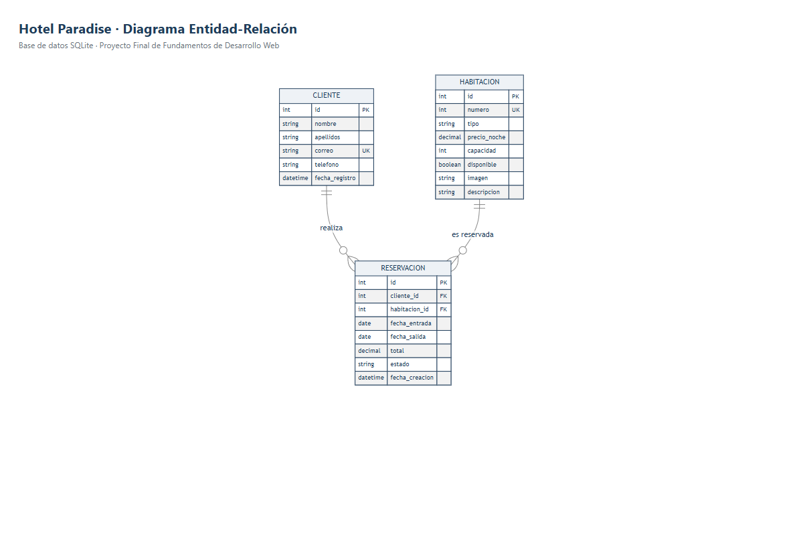

### Relaciones

| Relación | Tipo | Descripción |
| --- | --- | --- |
| Cliente → Reservación | 1:N | Un cliente puede tener muchas reservaciones; cada reservación pertenece a un solo cliente. |
| Habitación → Reservación | 1:N | Una habitación puede tener muchas reservaciones a lo largo del tiempo; cada reservación usa una sola habitación. |

La tabla **Reservación** funciona como tabla intermedia entre Cliente y Habitación y guarda las
fechas, el total, el estado y la fecha de creación.

### Modelo relacional

**CLIENTE**

| Campo | Tipo | Restricción |
| --- | --- | --- |
| id | Entero | Llave primaria |
| nombre | Texto (80) | Obligatorio |
| apellidos | Texto (120) | Obligatorio |
| correo | Correo (150) | Obligatorio, único |
| telefono | Texto (20) | Obligatorio, formato válido |
| fecha_registro | Fecha y hora | Automática |

**HABITACION**

| Campo | Tipo | Restricción |
| --- | --- | --- |
| id | Entero | Llave primaria |
| numero | Entero | Obligatorio, único, mayor que 0 |
| tipo | Texto | Individual / Doble / Suite / Presidencial |
| precio_noche | Decimal (10,2) | Mayor que 0 |
| capacidad | Entero | Mayor que 0 |
| disponible | Booleano | Valor por defecto: True |
| imagen | Imagen | Opcional |
| descripcion | Texto | Opcional |

**RESERVACION**

| Campo | Tipo | Restricción |
| --- | --- | --- |
| id | Entero | Llave primaria |
| cliente_id | Llave foránea | Referencia a Cliente (PROTECT) |
| habitacion_id | Llave foránea | Referencia a Habitación (PROTECT) |
| fecha_entrada | Fecha | Obligatoria |
| fecha_salida | Fecha | Debe ser mayor que la entrada |
| total | Decimal (10,2) | Calculado automáticamente |
| estado | Texto | Pendiente / Confirmada / Cancelada / Finalizada |
| fecha_creacion | Fecha y hora | Automática |

---

## 5. Arquitectura del proyecto

### Patrón MTV de Django

El proyecto sigue el flujo completo de Django:

```
Usuario → URL → Vista → Formulario → Modelo → Base de datos → Template → Navegador
```

| Capa | Archivos | Responsabilidad |
| --- | --- | --- |
| Modelo (M) | `habitaciones/models.py`, `clientes/models.py`, `reservaciones/models.py` | Define las tablas, relaciones y reglas de negocio. |
| Template (T) | `templates/` | Presenta la información con Bootstrap 5. |
| Vista (V) | `*/views.py` | Recibe la petición, consulta el ORM y devuelve una respuesta. |
| URL | `config/urls.py` y `*/urls.py` | Asocia cada ruta con su vista. |
| Formulario | `*/forms.py` | Valida los datos capturados por el usuario. |
| Admin | `*/admin.py` | Registra los modelos en el panel de Django. |

### Aplicaciones del proyecto

| App | Contenido |
| --- | --- |
| `core` | Dashboard, reportes y exportación a CSV. |
| `habitaciones` | Modelo, formularios, vistas y admin de habitaciones. |
| `clientes` | Modelo, formularios, vistas y admin de clientes. |
| `reservaciones` | Modelo, formularios, vistas, disponibilidad y cancelación. |
| `cuentas` | Login, logout, cambio de contraseña y control de usuarios. |

### Estructura de carpetas

```
hotel_paradise/
├── config/
│   ├── settings.py
│   ├── urls.py
│   └── wsgi.py
├── core/
│   ├── views.py
│   └── urls.py
├── habitaciones/
│   ├── models.py
│   ├── forms.py
│   ├── views.py
│   ├── urls.py
│   ├── admin.py
│   ├── tests.py
│   └── management/commands/cargar_demo.py
├── clientes/
├── reservaciones/
├── cuentas/
├── templates/
│   ├── base.html
│   ├── includes/
│   ├── core/
│   ├── habitaciones/
│   ├── clientes/
│   ├── reservaciones/
│   └── cuentas/
├── static/css/estilos.css
├── media/habitaciones/
├── docs/
├── manage.py
└── requirements.txt
```

### Flujo de una reservación

1. El empleado entra a **Reservaciones → Nueva reservación**.
2. Django recibe la petición en `reservaciones/urls.py` y la envía a `crear_reservacion`.
3. La vista crea un `ReservacionForm` con los datos enviados.
4. El formulario y el modelo validan fechas, disponibilidad y estado de la habitación con el ORM.
5. Si todo es correcto, `Reservacion.save()` calcula el total (noches × precio) y guarda el registro.
6. La vista redirige a la ficha de la reservación y muestra un mensaje de éxito.

---

## 6. Reglas de negocio

| Regla | Implementación | Archivo |
| --- | --- | --- |
| 1. Una habitación no se reserva dos veces en las mismas fechas | Consulta al ORM con traslape de fechas (`fecha_entrada < salida` y `fecha_salida > entrada`) y estados activos | `reservaciones/models.py`, método `Reservacion.clean` |
| 2. La fecha de salida debe ser mayor que la entrada | Comparación de fechas en el modelo y mensaje en el formulario | `reservaciones/models.py` y `reservaciones/forms.py` |
| 3. No se pueden repetir números de habitación | Campo `numero` con `unique=True` y validación en el formulario | `habitaciones/models.py` |
| 4. El correo del cliente debe ser único | Campo `correo` con `unique=True` y búsqueda sin distinguir mayúsculas | `clientes/models.py` y `clientes/forms.py` |
| 5. No se puede eliminar una habitación con reservaciones activas | Verificación antes de eliminar; además las llaves foráneas usan `PROTECT` | `habitaciones/views.py` y `reservaciones/models.py` |

Además, se agregaron validaciones adicionales:

- No se pueden registrar fechas de entrada anteriores al día actual.
- No se puede reservar una habitación marcada como no disponible.
- No se puede modificar ni cancelar una reservación finalizada.
- No se puede eliminar un cliente que tenga reservaciones registradas.

---

## 7. Explicación de los módulos

### 7.1 Módulo Habitaciones (Integrante 1)

**Responsabilidades cubiertas:** modelo Habitación, CRUD, administración de tipos, fotografías
y panel administrativo.

**Modelo:** `habitaciones/models.py`

- Campos: número, tipo, precio por noche, capacidad, disponible, imagen y descripción.
- `numero` es único (Regla 3) y el precio y la capacidad deben ser mayores que cero.
- Métodos `reservaciones_activas()`, `tiene_reservaciones_activas()` y
  `esta_disponible_en(fecha_entrada, fecha_salida)` reutilizados por reservaciones.

**Vistas:** `habitaciones/views.py`

- `lista_habitaciones`: listado con búsqueda por número, tipo o descripción, filtros por tipo y
  disponibilidad, y paginación de 8 registros.
- `detalle_habitacion`: ficha con fotografía, datos y reservaciones de la habitación.
- `crear_habitacion` y `editar_habitacion`: alta y modificación con carga de imagen.
- `eliminar_habitacion`: aplica la Regla 5 y captura `ProtectedError`.
- `tipos_habitacion`: resumen por tipo con total, disponibles y precio promedio.

**Formulario:** `HabitacionForm` con widgets de Bootstrap, validación de número, precio y capacidad.

**Panel administrativo:** `HabitacionAdmin` con búsqueda, filtros, edición rápida de
disponibilidad y vista previa de la imagen.

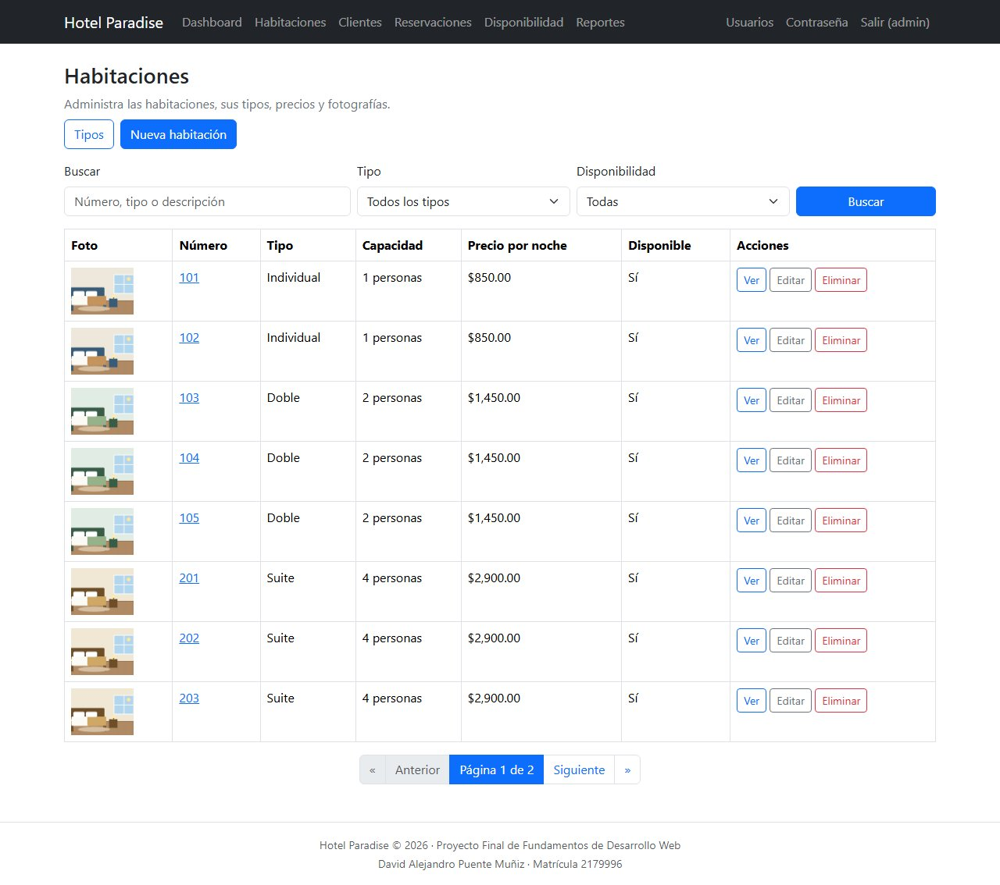

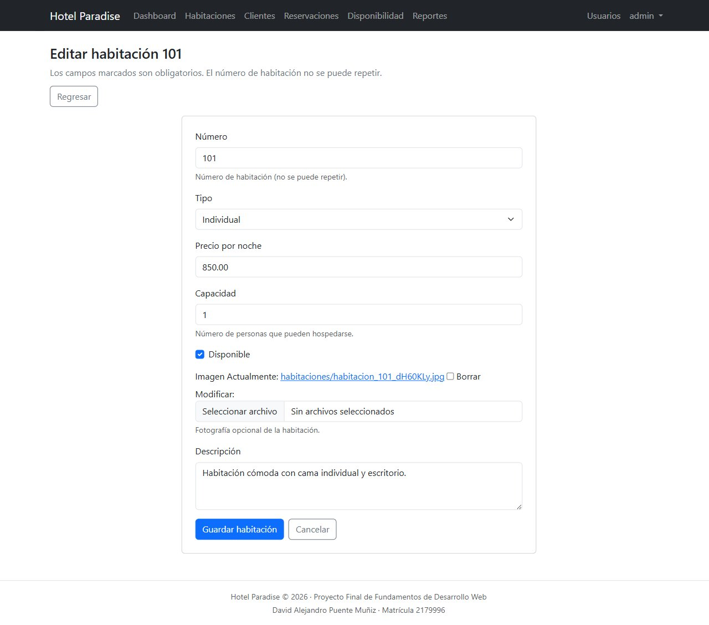

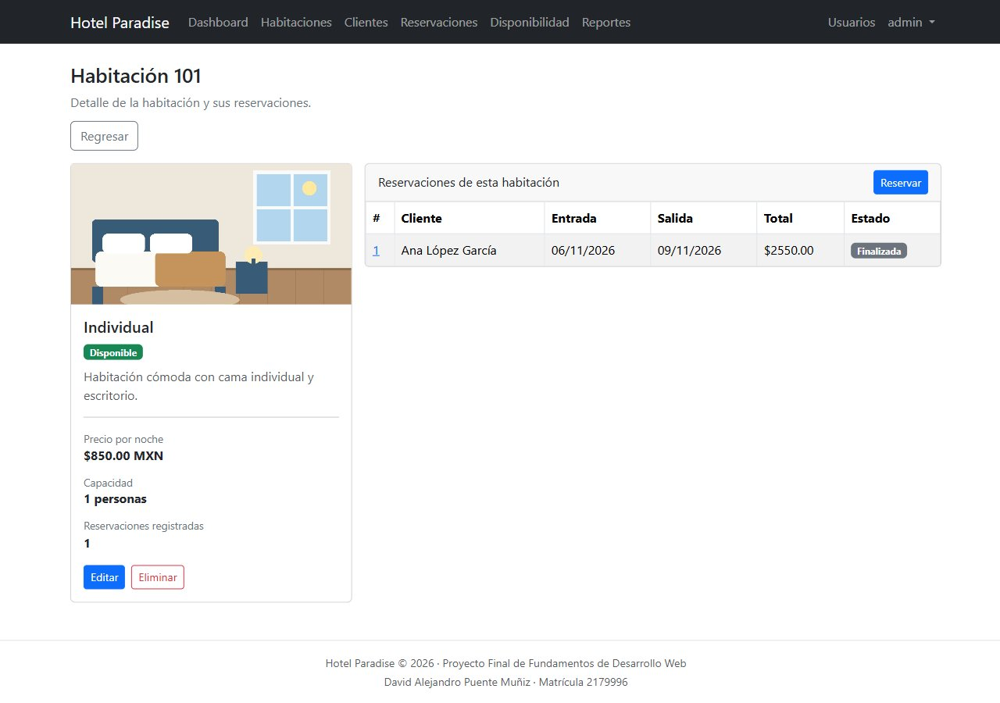

### 7.2 Módulo Clientes (Integrante 2)

**Responsabilidades cubiertas:** modelo Cliente, CRUD, validación de correo y búsquedas.

**Modelo:** `clientes/models.py`

- Campos: nombre, apellidos, correo, teléfono y fecha de registro automática.
- El correo es único (Regla 4) y se guarda en minúsculas para evitar duplicados.
- El teléfono se valida con una expresión regular.

**Vistas:** `clientes/views.py`

- Listado con búsqueda por nombre, apellidos, correo o teléfono y paginación.
- Ficha del cliente con su historial de reservaciones.
- CRUD completo con mensajes de éxito y error.
- Al eliminar, se protege el historial de reservaciones.

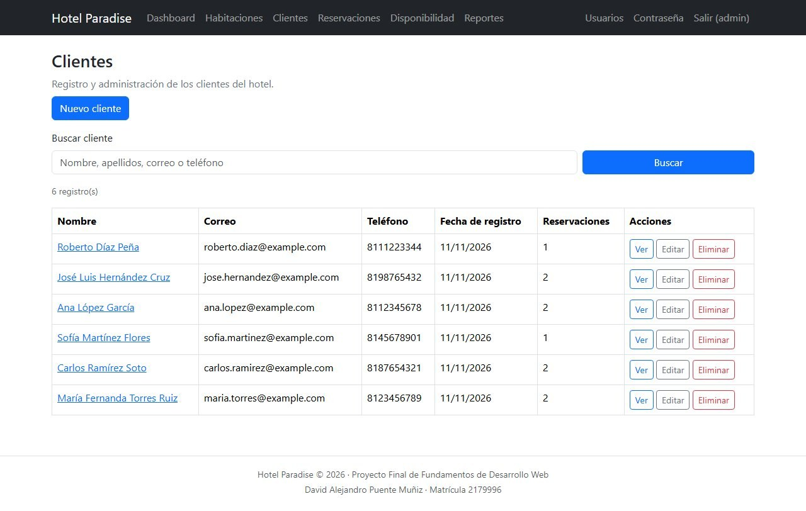

### 7.3 Módulo Reservaciones (Integrante 3)

**Responsabilidades cubiertas:** modelo Reservación, registro de reservas, validación de fechas
y consulta de disponibilidad.

**Modelo:** `reservaciones/models.py`

- Llaves foráneas a Cliente y Habitación con `on_delete=PROTECT`.
- `clean()` valida la Regla 1 y la Regla 2.
- `save()` calcula el total automáticamente: noches × precio por noche.
- Propiedad `noches` para mostrar la duración de la estancia.
- Estados: Pendiente, Confirmada, Cancelada y Finalizada.

**Vistas:** `reservaciones/views.py`

- Listado con búsqueda por cliente, correo o número de habitación; filtros por tipo y estado.
- `crear_reservacion` y `editar_reservacion` con validación de disponibilidad.
- `cancelar_reservacion`: cambia el estado a Cancelada (solo por POST).
- `consultar_disponibilidad`: recibe fechas, tipo y capacidad, y devuelve las habitaciones libres
  con el total estimado y un enlace para reservar.

**Formularios:** `ReservacionForm` y `DisponibilidadForm`.

**JavaScript:** el formulario muestra el total estimado mientras se capturan las fechas.

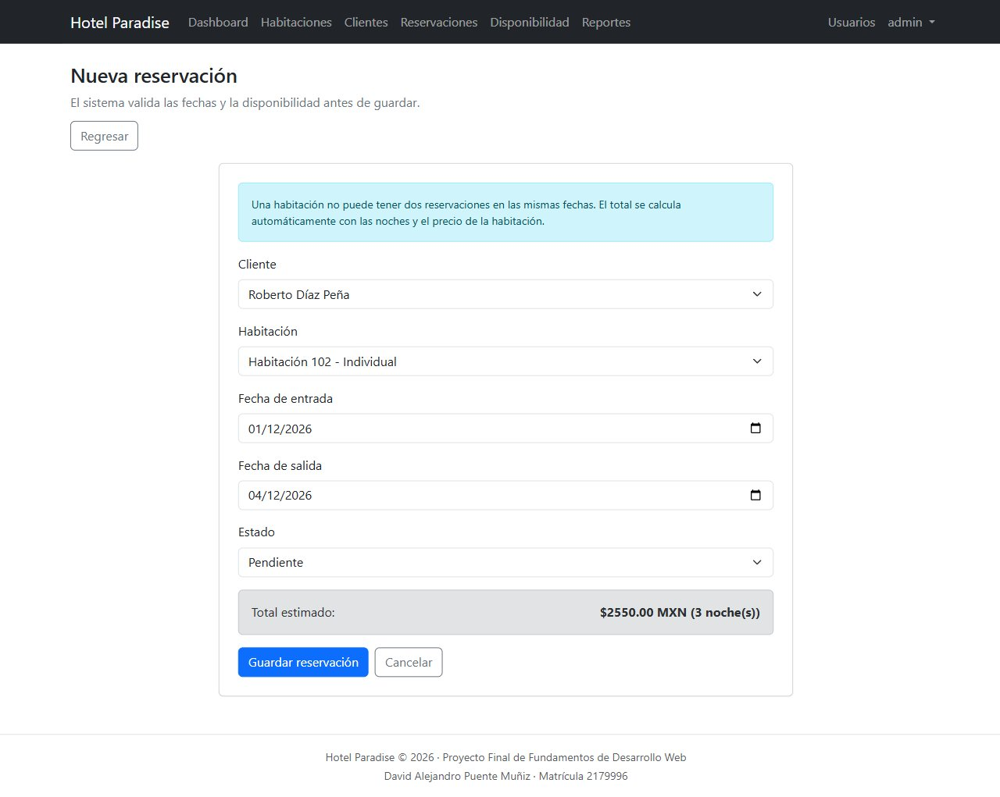

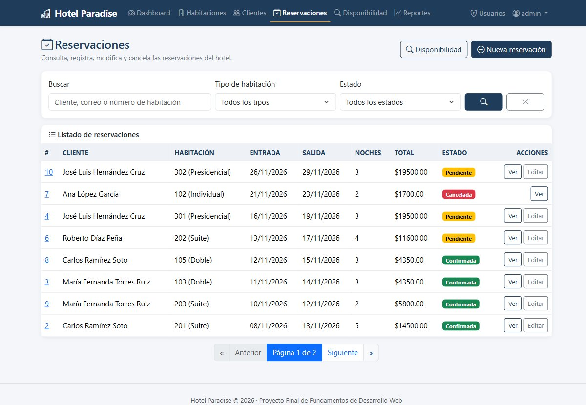

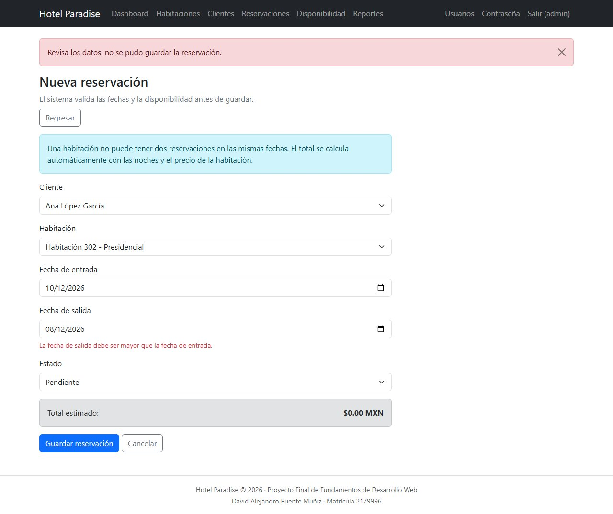

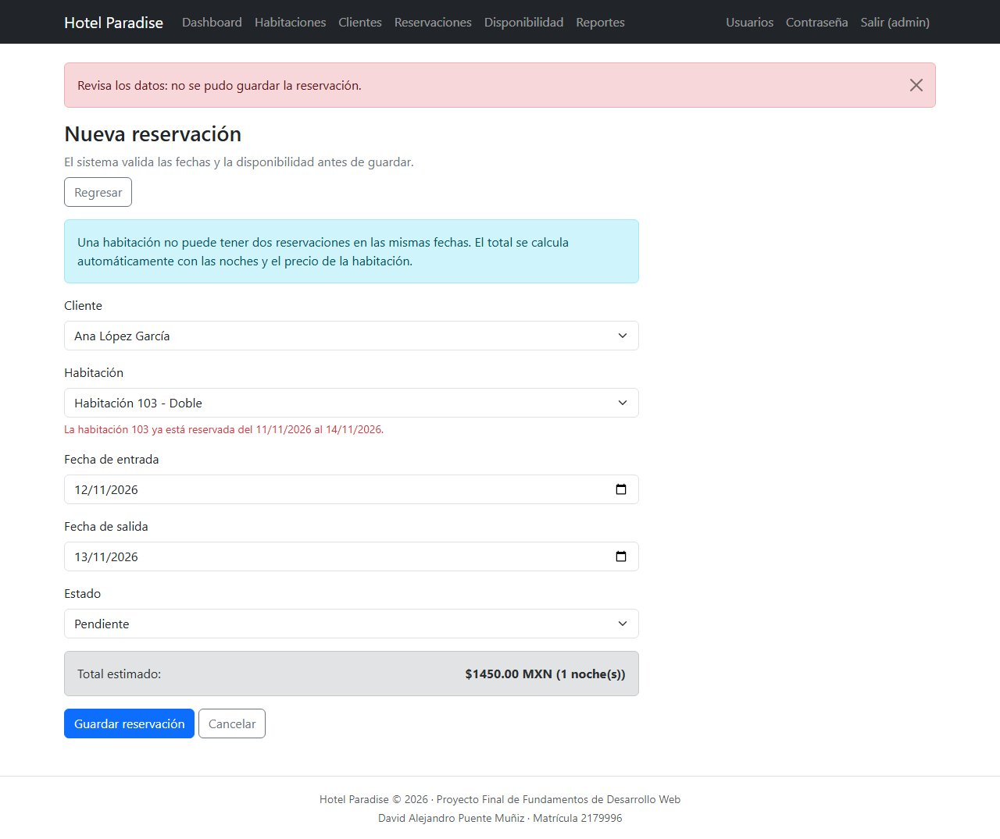

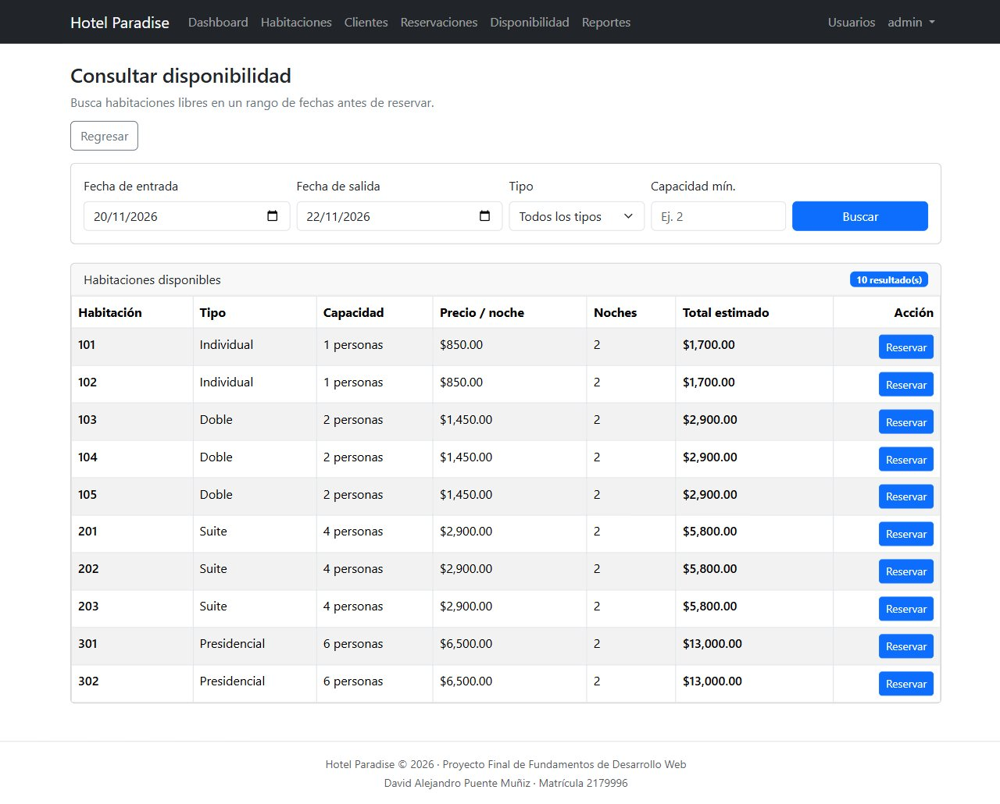

### 7.4 Interfaz Web (Integrante 4)

**Responsabilidades cubiertas:** Bootstrap 5, menús de navegación, templates, diseño responsivo y
dashboard principal.

- `templates/base.html` concentra la barra de navegación, los mensajes, el pie de página y los
  enlaces a Bootstrap 5 y a la hoja de estilos propia.
- `static/css/estilos.css` solo ajusta detalles sencillos (tamaño de títulos, tablas y
  fotografías); la mayor parte del estilo viene de las clases estándar de Bootstrap.
- Los templates están organizados por aplicación y comparten un include para los formularios y
  otro para la paginación.
- Las pantallas de listado usan tablas de Bootstrap y un formulario de búsqueda en la parte
  superior, sin componentes complicados.
- El dashboard muestra seis indicadores y dos tablas de actividad reciente.

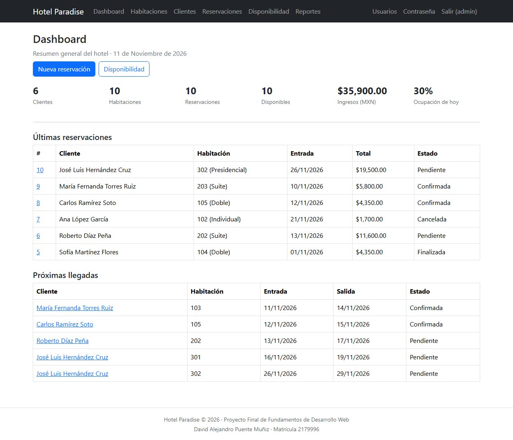

### 7.5 Seguridad y Reportes (Integrante 5)

**Responsabilidades cubiertas:** login, logout, control de usuarios, reportes y estadísticas.

- Login con `LoginView` y formulario personalizado; logout por POST.
- Cambio de contraseña con `PasswordChangeView`.
- Todas las vistas del sistema usan `@login_required`.
- El control de usuarios está restringido con `@user_passes_test` a usuarios con `is_staff`.
- Se pueden crear usuarios y activarlos o desactivarlos (sin desactivar el propio usuario).
- Reportes construidos con consultas avanzadas del ORM: `annotate`, `Count`, `Sum`, `Q` y
  `TruncMonth`.
- Exportación de reservaciones a CSV compatible con Excel.

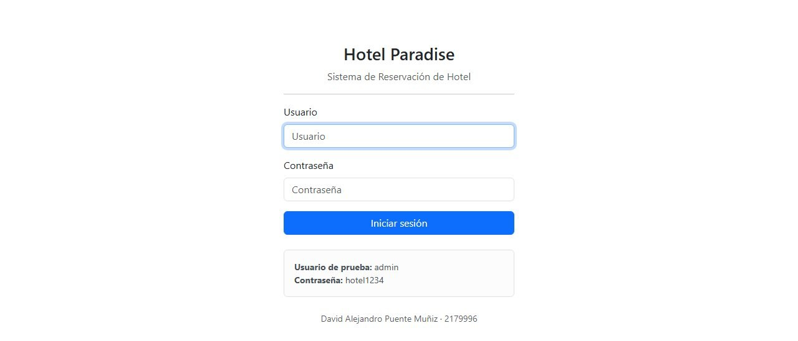

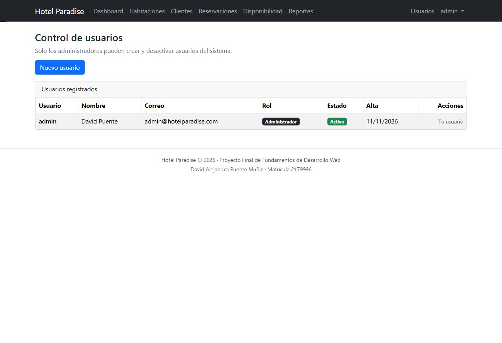

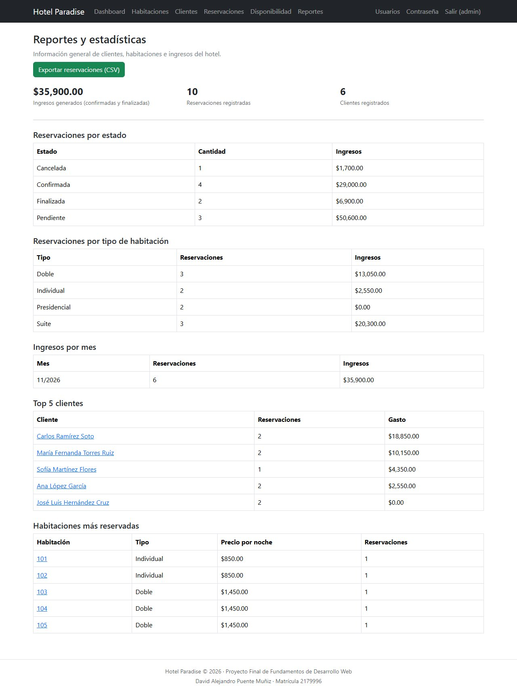

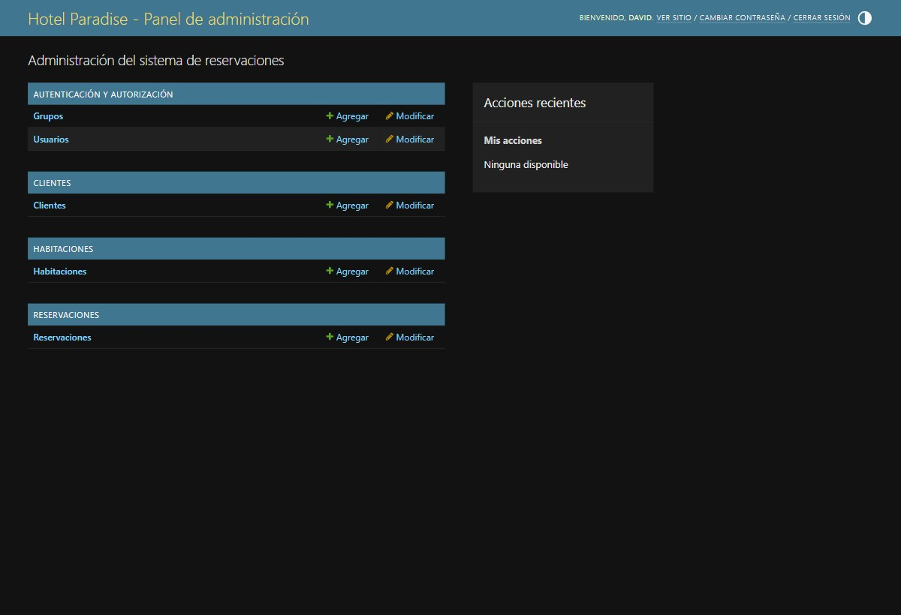

### 7.6 Dashboard

El dashboard presenta:

- Total de clientes.
- Total de habitaciones.
- Total de reservaciones.
- Habitaciones disponibles.
- Ingresos generados (reservaciones confirmadas y finalizadas).
- Porcentaje de ocupación del día.
- Últimas reservaciones y próximas llegadas.

La consulta de ingresos utiliza `Sum` y la ocupación se calcula con una consulta filtrada por
fechas y estado.

---

## 8. Funcionalidades adicionales

- Paginación en los listados.
- Mensajes de confirmación y error con Bootstrap.
- Búsquedas combinadas con varios filtros.
- Generación automática de imágenes de demostración con Pillow.
- Comando `cargar_demo` para inicializar el sistema con datos de prueba.
- 28 pruebas automatizadas.
- Exportación de reportes a CSV.
- Documentación técnica, manual de usuario y guion de video.

---

## 9. Pruebas funcionales

Las pruebas se ejecutan con:

```
python manage.py test
```

Resultado: **28 pruebas ejecutadas correctamente (OK)**.

| Módulo | Prueba | Resultado |
| --- | --- | --- |
| Habitaciones | Número de habitación repetido no es válido (Regla 3) | OK |
| Habitaciones | Precio mayor que cero | OK |
| Habitaciones | No elimina habitación con reservación activa (Regla 5) | OK |
| Habitaciones | Elimina habitación sin reservaciones | OK |
| Habitaciones | El listado requiere iniciar sesión | OK |
| Clientes | Correo duplicado no es válido (Regla 4) | OK |
| Clientes | Correo con formato inválido no es válido | OK |
| Clientes | Teléfono demasiado corto no es válido | OK |
| Clientes | Búsqueda por nombre | OK |
| Clientes | Búsqueda por correo | OK |
| Reservaciones | Fecha de salida debe ser mayor (Regla 2) | OK |
| Reservaciones | No permite reservaciones encimadas (Regla 1) | OK |
| Reservaciones | Permite fechas continuas (salida = siguiente entrada) | OK |
| Reservaciones | Total calculado automáticamente | OK |
| Reservaciones | Reservación cancelada no bloquea fechas | OK |
| Reservaciones | Cancelar reservación cambia el estado | OK |
| Reservaciones | Disponibilidad muestra solo habitaciones libres | OK |
| Dashboard | Requiere sesión | OK |
| Dashboard | Muestra las estadísticas | OK |

---

## 10. Capturas del sistema

| # | Captura | Archivo |
| --- | --- | --- |
| 1 | Inicio de sesión | `capturas/01_login.jpg` |
| 2 | Dashboard | `capturas/02_dashboard.jpg` |
| 3 | CRUD Habitaciones | `capturas/03_habitaciones_lista.jpg` |
| 4 | Detalle de habitación | `capturas/04_habitacion_detalle.jpg` |
| 5 | Formulario de habitación | `capturas/05_habitacion_formulario.jpg` |
| 6 | CRUD Clientes | `capturas/06_clientes_lista.jpg` |
| 7 | CRUD Reservaciones | `capturas/07_reservaciones_lista.jpg` |
| 8 | Consulta de disponibilidad | `capturas/08_disponibilidad.jpg` |
| 9 | Reportes y estadísticas | `capturas/09_reportes.jpg` |
| 10 | Control de usuarios | `capturas/10_usuarios.jpg` |
| 11 | Formulario de reservación | `capturas/11_reservacion_formulario.jpg` |
| 12 | Panel de administración | `capturas/12_admin.jpg` |
| 13 | Validación de fechas | `capturas/13_validacion_fechas.jpg` |
| 14 | Validación de disponibilidad | `capturas/14_validacion_disponibilidad.jpg` |
| 15 | Regla 5: no eliminar habitación con reservaciones activas | `capturas/15_regla_eliminar.jpg` |
| 16 | Diagrama Entidad-Relación | `capturas/16_diagrama_er.png` |

---

## 11. Conclusiones

El proyecto se desarrolló de forma individual cubriendo los cinco roles planteado en el PIA.
Las conclusiones se presentan por módulo, de acuerdo con la responsabilidad que correspondería a
cada integrante.

### Integrante 1 - Módulo Habitaciones

Aprendí a diseñar un modelo con validaciones y a reutilizar métodos del modelo para consultar
disponibilidad. El CRUD de habitaciones me permitió comprender cómo se conectan el formulario, la
vista y el template, y la importancia de proteger la información relacionada antes de eliminar un
registro.

### Integrante 2 - Módulo Clientes

La validación del correo único y del teléfono me mostraron que las reglas del negocio deben
vivir tanto en el modelo como en el formulario. Las búsquedas con `Q` y `icontains` facilitan
mucho la operación diaria del hotel y son sencillas de implementar con el ORM.

### Integrante 3 - Módulo Reservaciones

Fue el módulo más completo: aprendí a detectar traslapes de fechas con consultas del ORM, a
calcular el total en el modelo y a cancelar reservaciones sin perder el historial. También
comprendí la importancia de validar en el servidor y no solo en el navegador.

### Integrante 4 - Interfaz Web

Bootstrap 5 permitió construir una interfaz limpia y responsiva sin escribir demasiado CSS.
Trabajar con un template base, includes y mensajes flash ayuda a mantener consistencia y a
reutilizar código en todas las pantallas.

### Integrante 5 - Seguridad y Reportes

Implementar login, permisos y reportes me mostró que una aplicación web no solo debe funcionar,
sino también proteger la información. Las consultas con `annotate`, `Sum` y `TruncMonth`
demuestran el potencial del ORM para generar estadísticas sin escribir SQL manual.

### Conclusión general

El sistema cumple con los requerimientos del PIA: modelos y relaciones correctas, CRUDs
funcionales, validación de disponibilidad, formularios con validaciones, interfaz con Bootstrap,
dashboard, reportes, autenticación y documentación. El desarrollo del proyecto reforzó el flujo
completo de Django y demostró que una buena planeación de la base de datos simplifica la
programación de las vistas y los templates.

---

## 12. Referencias

- Documentación oficial de Django: <https://docs.djangoproject.com/>
- Documentación de Bootstrap 5: <https://getbootstrap.com/docs/5.3/>
- Documentación de Python: <https://docs.python.org/3/>
- Material del curso de Fundamentos de Desarrollo Web.
