# Manual de Usuario

## Sistema de Reservación de Hotel "Hotel Paradise"

**Materia:** Fundamentos de Desarrollo Web  
**Alumno:** David Alejandro Puente Muñiz  
**Matrícula:** 2179996  
**Docente:** [Escribir el nombre del docente]  
**Fecha:** 11 de noviembre de 2026

---

## 1. Introducción

Este manual explica cómo instalar, iniciar sesión y utilizar el sistema Hotel Paradise para
administrar habitaciones, clientes, reservaciones y reportes.

### Requisitos

- Python 3.11 o superior.
- Django 5.2 y Pillow (se instalan con `requirements.txt`).
- Navegador web actualizado (Chrome, Edge, Firefox o Safari).

---

## 2. Instalación y arranque

1. Abrir una terminal en la carpeta del proyecto.
2. Instalar las dependencias:

   ```
   pip install -r requirements.txt
   ```

3. Crear la base de datos:

   ```
   python manage.py migrate
   ```

4. Cargar los datos de ejemplo (crea habitaciones, clientes, reservaciones y el usuario admin):

   ```
   python manage.py cargar_demo
   ```

5. Iniciar el servidor:

   ```
   python manage.py runserver
   ```

6. Abrir en el navegador la dirección <http://127.0.0.1:8000/>.

---

## 3. Inicio de sesión

Al entrar al sistema se muestra la pantalla de inicio de sesión.

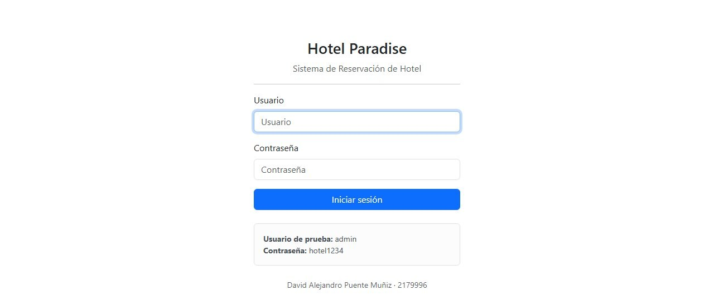

1. Escribir el **usuario** y la **contraseña**.
2. Presionar **Iniciar sesión**.

Credenciales de prueba:

| Usuario | Contraseña |
| --- | --- |
| `admin` | `hotel1234` |

Si los datos son incorrectos aparece el mensaje "Usuario o contraseña incorrectos". Si el usuario
fue desactivado por un administrador, tampoco podrá entrar.

> Todas las pantallas del sistema requieren iniciar sesión. Si se intenta abrir una dirección
> directamente, el sistema redirige al login.

---

## 4. Menú principal y dashboard

Después de iniciar sesión se muestra el dashboard.

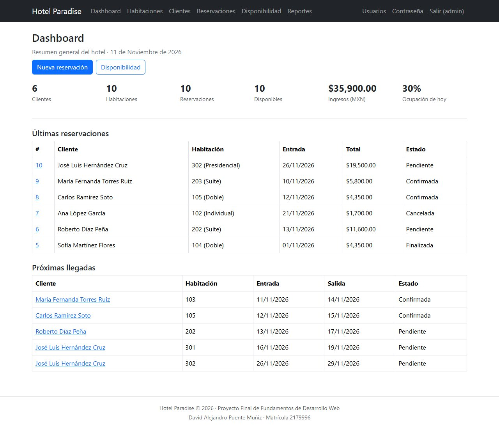

En la barra superior se encuentran los accesos a:

- **Dashboard:** resumen general.
- **Habitaciones:** administración de habitaciones.
- **Clientes:** administración de clientes.
- **Reservaciones:** administración de reservaciones.
- **Disponibilidad:** consulta de habitaciones libres.
- **Reportes:** estadísticas y exportación.
- **Usuarios:** solo visible para administradores.
- **Contraseña:** cambiar la contraseña del usuario actual.
- **Salir (usuario):** cerrar la sesión.

El dashboard muestra:

- Total de clientes.
- Total de habitaciones.
- Total de reservaciones.
- Habitaciones disponibles.
- Ingresos generados.
- Porcentaje de ocupación del día.
- Últimas reservaciones y próximas llegadas.

---

## 5. Registro de habitaciones

### Consultar habitaciones

1. Entrar a **Habitaciones** en el menú.
2. Se muestra una tabla con la fotografía, el número, el tipo, la capacidad, el precio y la
   disponibilidad de cada habitación.

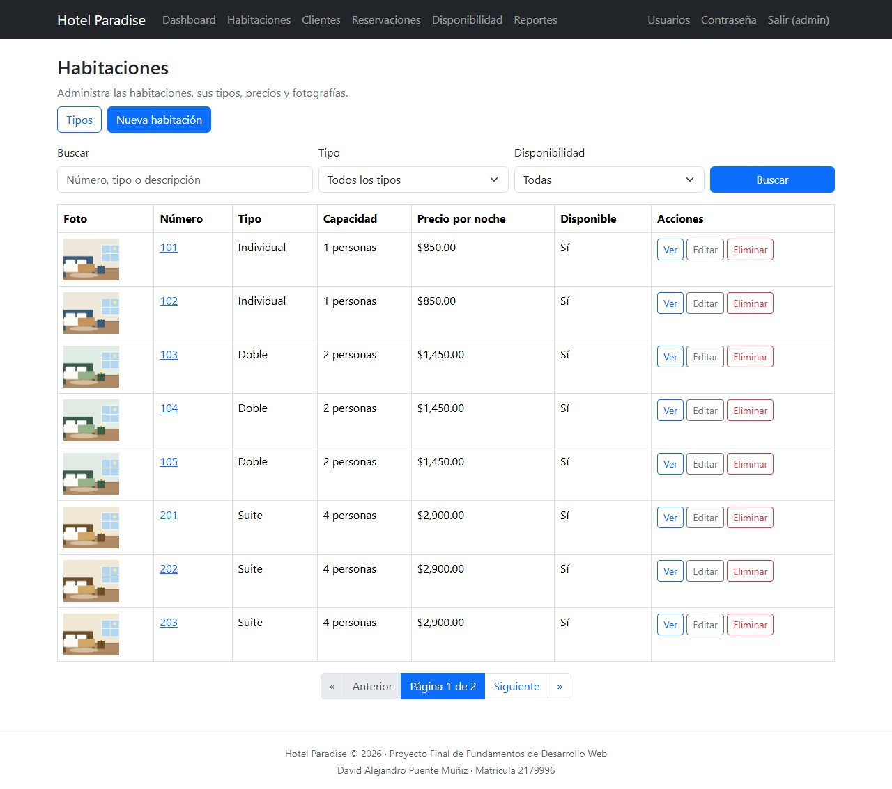

### Buscar y filtrar

1. Escribir el número, tipo o descripción en el campo **Buscar**.
2. Seleccionar un **Tipo** o una **Disponibilidad** si se desea.
3. Presionar el botón **Buscar**.
4. Para limpiar los filtros, presionar **Limpiar**.

### Registrar una habitación

1. Presionar **Nueva habitación**.
2. Capturar los datos:

   - **Número:** obligatorio y no se puede repetir.
   - **Tipo:** Individual, Doble, Suite o Presidencial.
   - **Precio por noche:** mayor que cero.
   - **Capacidad:** número de personas.
   - **Disponible:** marcar si la habitación puede reservarse.
   - **Imagen:** fotografía opcional.
   - **Descripción:** texto opcional.

3. Presionar **Guardar habitación**.

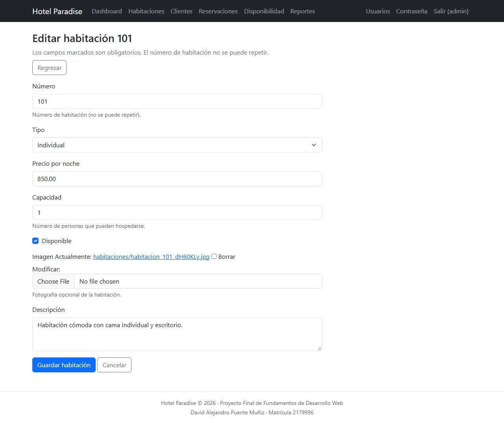

Si el número ya existe, el sistema muestra un error y no guarda el registro.

### Editar una habitación

1. Localizar la habitación.
2. Presionar **Editar**.
3. Modificar los datos y presionar **Guardar habitación**.

### Eliminar una habitación

1. Localizar la habitación.
2. Presionar **Eliminar**.
3. Confirmar la operación.

> **Regla de negocio:** no se puede eliminar una habitación con reservaciones activas. Si se
> intenta, el sistema muestra un aviso y conserva el registro.

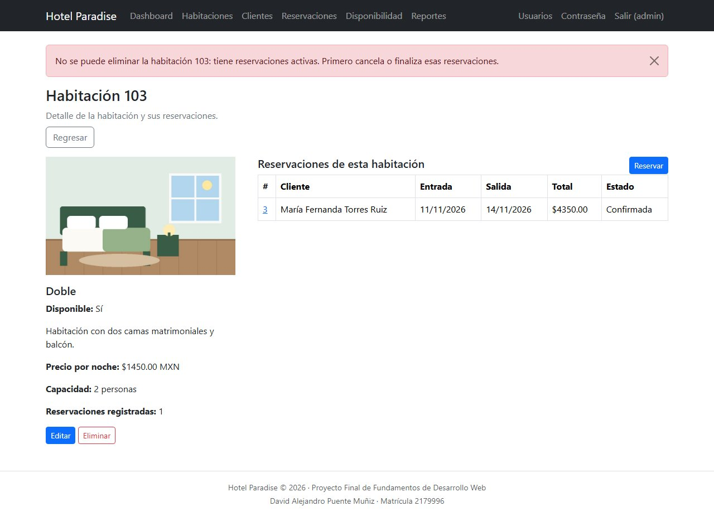

### Consultar los tipos de habitación

1. Entrar a **Habitaciones**.
2. Presionar **Tipos**.
3. Se muestra cuántas habitaciones hay de cada tipo, cuántas están disponibles y su precio promedio.

---

## 6. Registro de clientes

### Consultar y buscar clientes

1. Entrar a **Clientes**.
2. Escribir en el buscador el nombre, apellidos, correo o teléfono.
3. Presionar el botón de búsqueda.

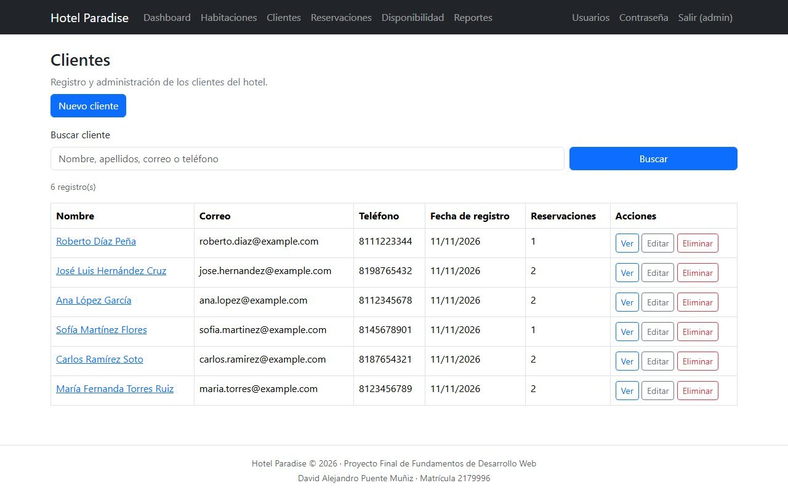

### Registrar un cliente

1. Presionar **Nuevo cliente**.
2. Capturar nombre, apellidos, correo y teléfono.
3. Presionar **Guardar cliente**.

Validaciones:

- El correo debe tener formato válido y ser único.
- No se permiten dos clientes con el mismo correo, aunque cambien mayúsculas y minúsculas.
- El teléfono debe tener al menos 7 dígitos y solo puede incluir números, `+`, `-`, espacios y paréntesis.

### Editar un cliente

1. Localizar el cliente y presionar **Editar**.
2. Modificar los datos y guardar.

### Eliminar un cliente

1. Localizar el cliente y presionar **Eliminar**.
2. Confirmar la operación.

> No se puede eliminar un cliente que tenga reservaciones registradas, para conservar el
> historial del hotel.

### Ver el historial de un cliente

1. Presionar **Ver** en el listado.
2. Se muestran sus datos y todas sus reservaciones.

---

## 7. Registro de reservaciones

### Consultar disponibilidad

1. Entrar a **Disponibilidad**.
2. Seleccionar la **fecha de entrada** y la **fecha de salida**.
3. Opcionalmente elegir un **tipo de habitación** y una **capacidad mínima**.
4. Presionar **Buscar**.

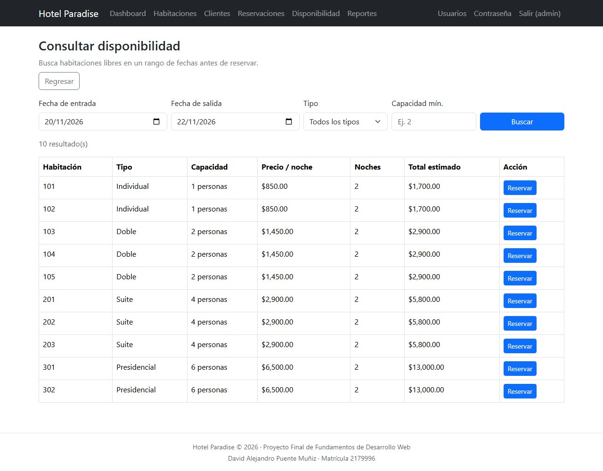

El sistema muestra las habitaciones libres, las noches, el precio por noche y el total estimado.
El botón **Reservar** abre el formulario con los datos precargados.

### Registrar una reservación

1. Entrar a **Reservaciones** y presionar **Nueva reservación**.
2. Seleccionar el **cliente** y la **habitación**.
3. Capturar la **fecha de entrada** y la **fecha de salida**.
4. Elegir el **estado** (por defecto Pendiente).
5. Verificar el **total estimado** que se calcula automáticamente.
6. Presionar **Guardar reservación**.

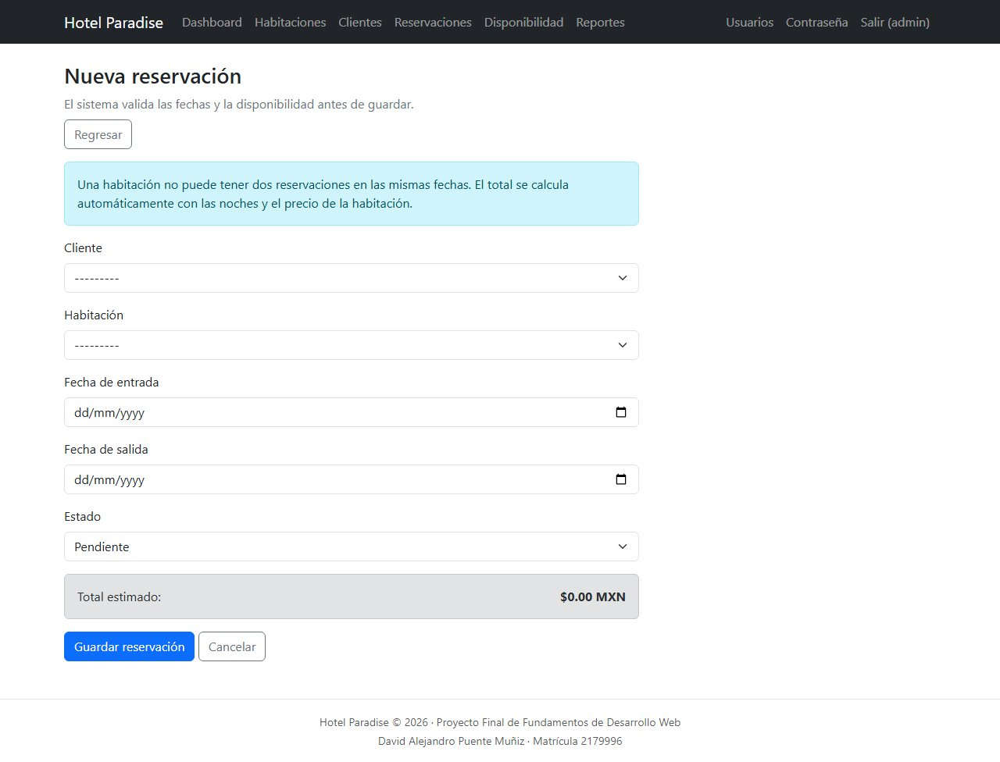

El total definitivo se calcula en el servidor: **noches × precio por noche**.

### Validaciones de fechas y disponibilidad

- La fecha de salida debe ser mayor que la fecha de entrada.
- La fecha de entrada no puede ser anterior a hoy.
- Una habitación no puede tener dos reservaciones en las mismas fechas.
- No se puede reservar una habitación marcada como no disponible.

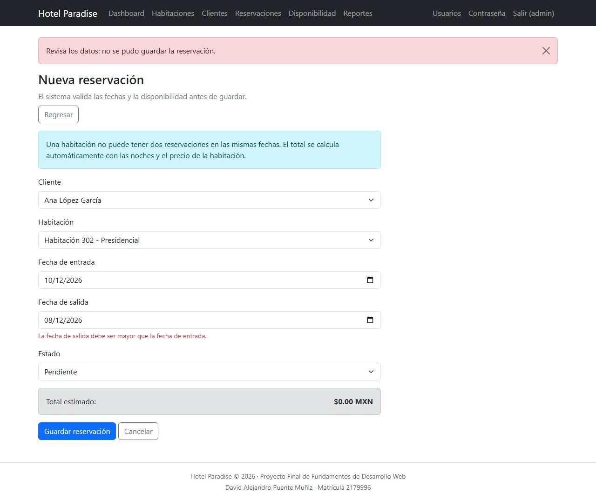

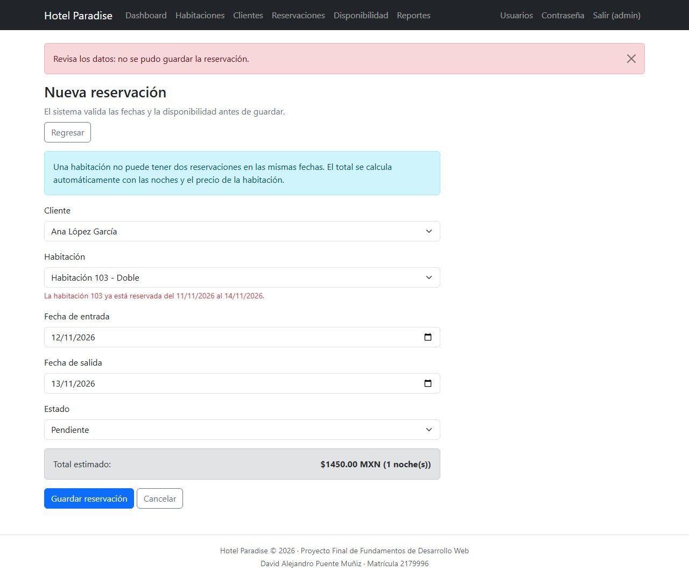

> Si dos reservaciones son continuas (un cliente sale el mismo día que entra otro), el sistema
> sí lo permite, porque las noches no se traslapan.

### Consultar reservaciones

1. Entrar a **Reservaciones**.
2. Usar el buscador por cliente, correo o número de habitación.
3. Filtrar por tipo de habitación o estado.
4. Presionar **Ver** para abrir la ficha completa.

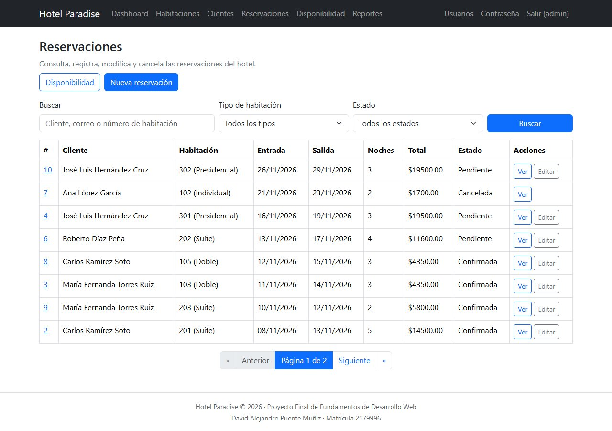

### Modificar una reservación

1. Abrir la reservación con **Ver** o **Editar**.
2. Cambiar los datos necesarios.
3. Presionar **Guardar reservación**.

No se pueden modificar reservaciones canceladas o finalizadas.

### Cancelar una reservación

1. Abrir la ficha de la reservación.
2. Presionar **Cancelar reservación**.
3. Confirmar la operación.

La reservación conserva su historial y cambia al estado **Cancelada**; sus fechas quedan libres
para una nueva reservación.

---

## 8. Reportes

1. Entrar a **Reportes** en el menú.
2. Se muestran los ingresos totales, las reservaciones registradas y los clientes.
3. Revisar las tablas de reservaciones por estado, por tipo de habitación, ingresos por mes,
   top 5 clientes y habitaciones más reservadas.

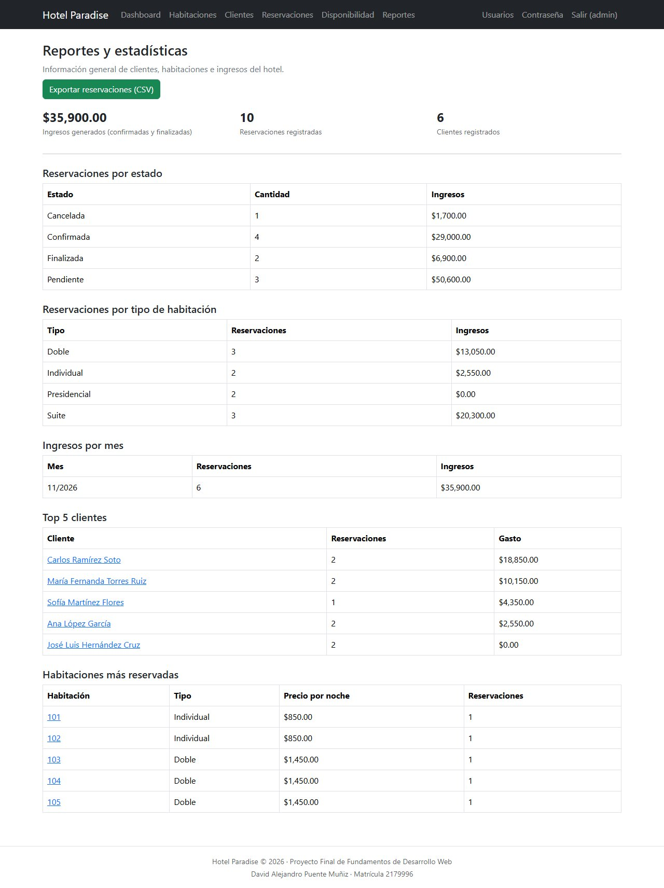

### Exportar a CSV

1. Presionar **Exportar reservaciones (CSV)**.
2. El navegador descarga el archivo `reporte_reservaciones.csv`.
3. El archivo se puede abrir con Excel.

---

## 9. Control de usuarios (solo administradores)

1. Entrar a **Usuarios** en el menú superior.
2. Se muestra la lista de usuarios con su rol y estado.

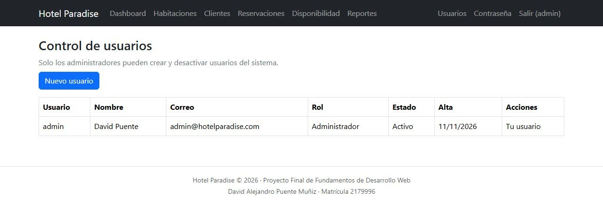

### Crear un usuario

1. Presionar **Nuevo usuario**.
2. Capturar usuario, nombre, apellidos, correo y contraseña (dos veces).
3. Marcar **¿Es administrador?** si el usuario podrá entrar al panel de Django y administrar usuarios.
4. Presionar **Crear usuario**.

### Activar o desactivar un usuario

1. Localizar el usuario.
2. Presionar **Desactivar** o **Activar**.
3. El usuario desactivado ya no podrá iniciar sesión.

> Un administrador no puede desactivar su propio usuario.

### Cambiar la contraseña

1. Presionar **Contraseña** en la barra superior.
2. Capturar la contraseña actual y la nueva dos veces.
3. Guardar.

---

## 10. Panel de administración de Django

1. Escribir la dirección <http://127.0.0.1:8000/admin/> en el navegador.
2. Iniciar sesión con un usuario administrador.

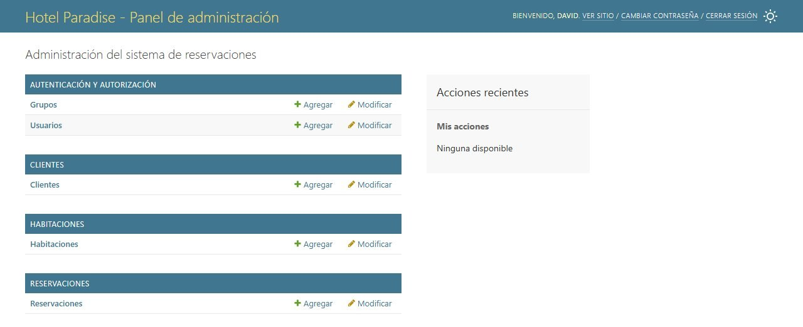

Desde este panel se pueden administrar usuarios, grupos, clientes, habitaciones y reservaciones
con las herramientas propias de Django.

---

## 11. Cerrar sesión

1. Presionar **Salir (usuario)** en la barra superior.
2. El sistema regresa a la pantalla de inicio de sesión.

---

## 12. Solución de problemas

| Problema | Causa probable | Solución |
| --- | --- | --- |
| No puedo iniciar sesión | Usuario o contraseña incorrectos, o usuario desactivado | Verificar los datos o pedir a un administrador que active la cuenta. |
| La página no carga | El servidor no está encendido | Ejecutar `python manage.py runserver`. |
| Las imágenes no aparecen | Faltan archivos en `media/` | Ejecutar `python manage.py cargar_demo` o volver a subir la imagen. |
| Error "no such table" | No se aplicaron las migraciones | Ejecutar `python manage.py migrate`. |
| No veo el enlace Usuarios | El usuario no es administrador | Entrar con una cuenta con permisos de administrador. |
| No puedo guardar una reservación | Fechas inválidas o habitación ocupada | Revisar las fechas y consultar la disponibilidad. |

---

## 13. Cierre

El sistema Hotel Paradise permite realizar todo el flujo de operación del hotel: iniciar sesión,
registrar habitaciones y clientes, consultar disponibilidad, crear y cancelar reservaciones, y
revisar los reportes de ingresos y ocupación. Para cualquier cambio de datos, el sistema valida
automáticamente las reglas del negocio y conserva el historial.
